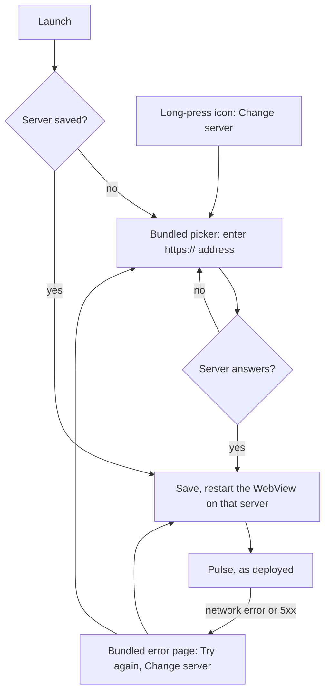

# Pulse as a native app (Capacitor)

`mobile/` is a thin [Capacitor](https://capacitorjs.com) shell: an Android and iOS app that opens **your** Pulse server
in a native WebView. Pulse is self-hosted, so one build works for every server: on first launch the app asks for the
server's address and remembers it. The web app inside is the deployed site, so a deploy reaches the app at once; only
a change in `mobile/` needs a new build.



## What is in it

| Piece | Where | Notes |
|---|---|---|
| Config | `mobile/capacitor.config.json` | App id, name, background, `errorPath`. No `server.url`: the server is chosen at runtime. |
| Picker | `mobile/www/index.html` | Bundled. Normalises the address to an `https://` origin and checks that it answers (any HTTP status counts, so a sign-in redirect from an access proxy passes). |
| Error page | `mobile/www/error.html` | Bundled and self-contained. Shown when the server can't be reached or answers 5xx; Pulse's own 404s stay visible. |
| Android runtime | `mobile/android/app/src/main/java/.../MainActivity.java`, `ServerStore.java`, `PulseServerPlugin.java`, `ShellWebViewClient.java` | The app's origin stays the bundled `https://localhost`; the saved server is loaded as a plain page that `ShellWebViewClient` lets into the WebView. System Back walks the server's history. |
| iOS runtime | `mobile/ios/App/App/PulseShell.swift`, `SceneDelegate.swift` | Sets the saved server through `instanceDescriptor()`, and answers plugin calls only from the bundled `capacitor://localhost` pages. |
| `PulseServer` plugin | both | `get()`, `set({ url })`, `pick()`. `set` and `pick` restart the WebView. Callable from the bundled pages only. |
| Change server | Android `res/xml/shortcuts.xml`, iOS `UIApplicationShortcutItems` | Long-press the app icon. |
| Icons and launch screens | `mobile/scripts/gen-assets.py` → `mobile/assets/` → `pnpm assets` | Same mark and colours as the PWA icons. |
| CI | `.github/workflows/mobile.yml` | Builds the APK; signs and publishes it when the secrets are set. |

Navigation stays on the server (same scheme, host and port) and on `*.cloudflareaccess.com` (Cloudflare Access
sign-in). Any other host opens in the system browser. Behind a different sign-in proxy (Authelia, Authentik, …), add
its host to `AUTH_HOST_SUFFIX` in `ServerStore.java` and `authHosts` in `PulseShell.swift`.

Neither the server nor its sign-in proxy can reach native code: Capacitor's plugins (including `CapacitorHttp`, which
skips CORS) answer only the bundled picker and error page. On Android the bridge is injected only into the app's own
`https://localhost` origin, and the app refuses to open a server on a WebView too old for origin-scoped messaging; on
iOS a message handler drops calls from any other origin.

## Build for Android

Needs Node 24, pnpm, JDK 21 and the Android SDK (platform 36, via Android Studio or `sdkmanager`).

```sh
cd mobile
pnpm install
pnpm apk:debug            # android/app/build/outputs/apk/debug/app-debug.apk
pnpm android              # or open the project in Android Studio
```

### Sign a release

Make a key once, and keep it (and its passwords) safe and out of the repo. Every update must be signed with the same
key, or users have to uninstall first.

```sh
keytool -genkeypair -v -keystore ~/pulse-release.jks -alias pulse -keyalg RSA -keysize 4096 -validity 10000
```

Point the build at it in `mobile/android/keystore.properties` (gitignored):

```properties
storeFile=/Users/you/pulse-release.jks
storePassword=…
keyAlias=pulse
keyPassword=…
```

Then `pnpm apk` builds `android/app/build/outputs/apk/release/app-release.apk`. Copy it to the phone and open it
(allow installs from that source). Uninstall a PWABuilder APK of the same site first, or you will have two icons.

### CI and releases

Set these repository secrets and `.github/workflows/mobile.yml` signs the APK on `main` and on manual runs, and
attaches it to a GitHub release for a `mobile-v*` tag (`git tag mobile-v0.1.0 && git push origin mobile-v0.1.0`).
Pull requests build an unsigned release as a check.

| Secret | Value |
|---|---|
| `PULSE_KEYSTORE_BASE64` | `base64 -i pulse-release.jks` |
| `PULSE_KEYSTORE_PASSWORD`, `PULSE_KEY_ALIAS`, `PULSE_KEY_PASSWORD` | As above |

The version code is the workflow run number, so each CI build installs over the last.

## Build for iOS

Needs a Mac with Xcode, and an Apple Developer account to install on a phone for longer than a week or to use
TestFlight.

```sh
cd mobile
pnpm install
pnpm exec cap sync ios
pnpm ios                  # opens Xcode
```

In Xcode, pick your team under Signing & Capabilities (change the bundle id if `io.github.adityaongit.pulse` is
taken for your team), then run on a device, or Product › Archive for TestFlight.

## Rebrand it for your fork

1. **App id and name.** `appId` and `appName` in `mobile/capacitor.config.json`; on Android also `namespace` and
   `applicationId` in `android/app/build.gradle`, the Java package folder, `package_name` in `strings.xml` and the
   shortcut's `targetPackage` and action; on iOS the bundle id in Xcode and the shortcut type in `Info.plist` and
   `PulseShell.swift`.
2. **Icons and launch screens.** Change the mark in `mobile/scripts/gen-assets.py` and run `pnpm assets`.

## What the app does differently from the PWA

| | Android app | iOS app | PWA |
|---|---|---|---|
| Any Pulse server from one install | Yes | Yes | Yes (it is the site) |
| Push notifications | No: Web Push doesn't run in a WebView | No | Yes |
| Connect Google | Opens in the browser, which must be signed in to Pulse | Same | In place |
| Offline copy of the last pages | Yes (Pulse's service worker runs in the WebView) | No (WKWebView runs service workers only for app-bound domains) | Yes |
| Long-press shortcuts | Change server | Change server | Check in, Recovery, Sleep |
| Back | System back walks the page's history; on the first page the app goes to the background | Edge swipe is off; the header's Back works | As the browser |

## Decisions and dead ends

- **A shell, not a Trusted Web Activity.** A TWA (PWABuilder, [pwa.md](pwa.md#android-apk-with-pwabuilder)) is
  verified against one site's `assetlinks.json`, so each self-hoster has to build and sign their own APK. The shell
  loads any server, and its own pages (picker, error page) work before any server is set.
- **The server is chosen at runtime, not baked in,** and restarting the WebView switches it. Android does not use
  `server.url` at all: that would make the server the app's origin and hand it the native bridge. iOS sets it in
  `instanceDescriptor()`, with a trailing slash because Capacitor matches app URLs by prefix
  (`https://pulse.example.com` would also match `https://pulse.example.com.evil.test`), and filters the bridge's
  messages by origin.
- **The server is untrusted.** A mistyped or hostile address must not get native plugins, so only bundled pages do.
- **No prefilled server.** The app is for any Pulse, so the picker starts empty.
- **HTTPS only.** Android blocks cleartext by default, and a session cookie over plain HTTP would be readable on the
  network. For a LAN dev server use a tunnel ([pwa.md](pwa.md#test-it)).
- **Not yet:** native push (FCM/APNs on the server, beside Web Push) and an in-app Connect Google (a one-time handoff
  token so the browser doesn't need its own Pulse session, and a deep link back to the app).
